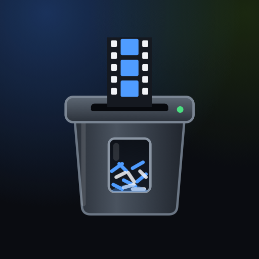
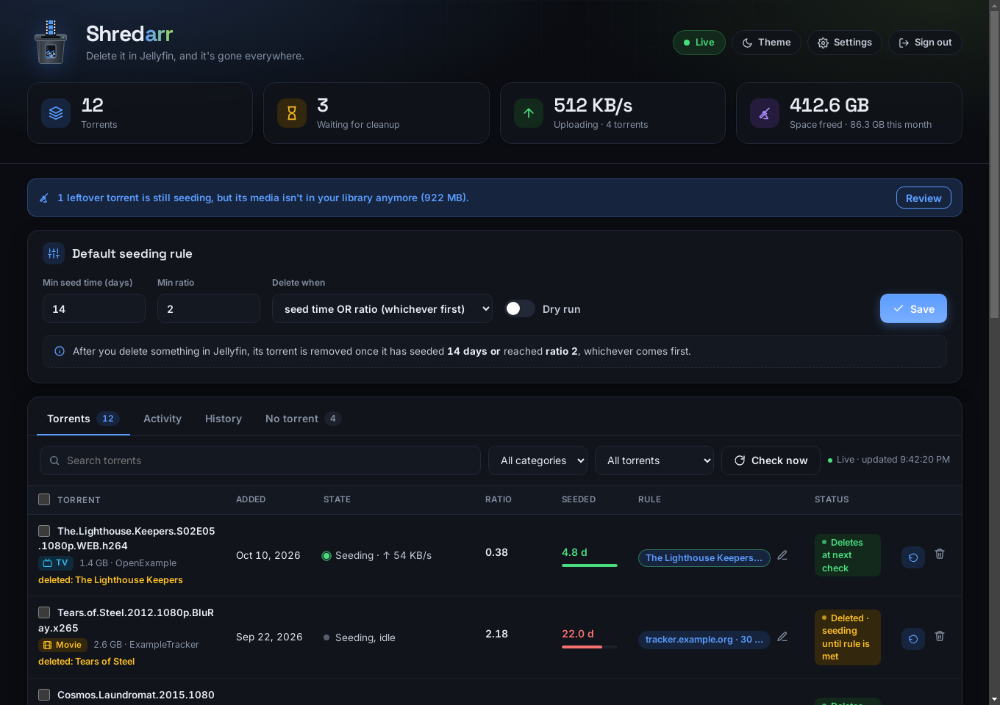
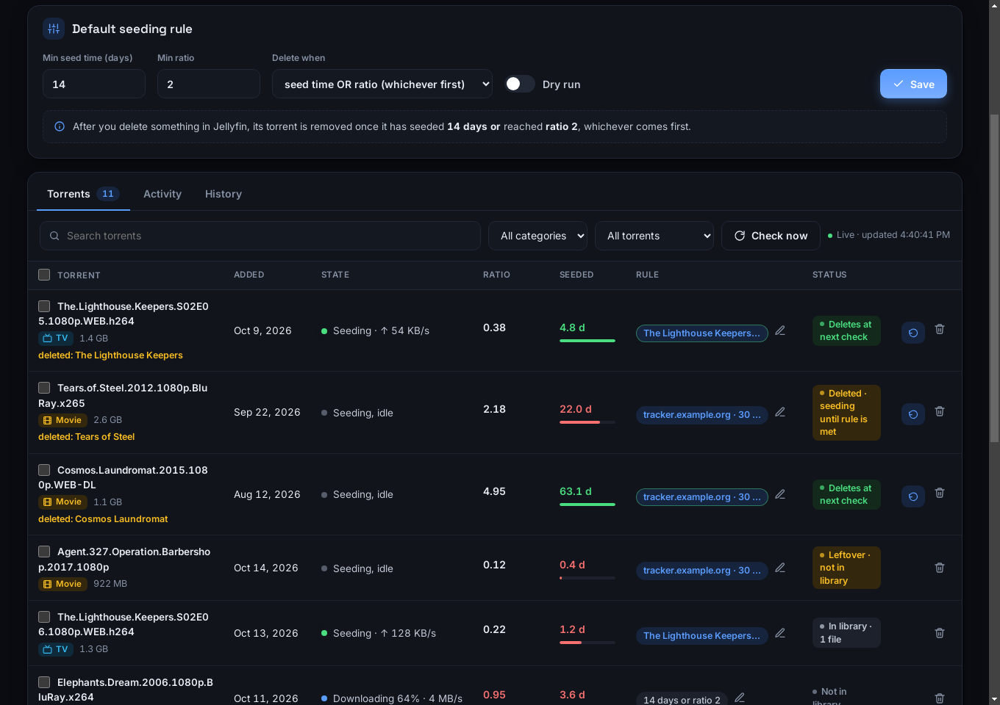
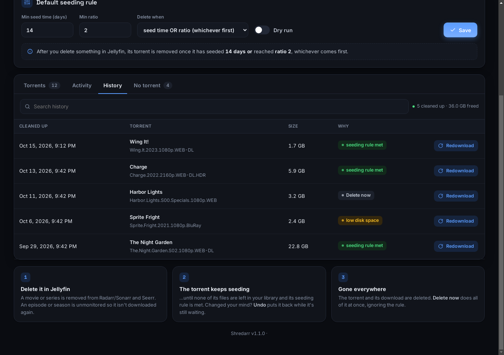
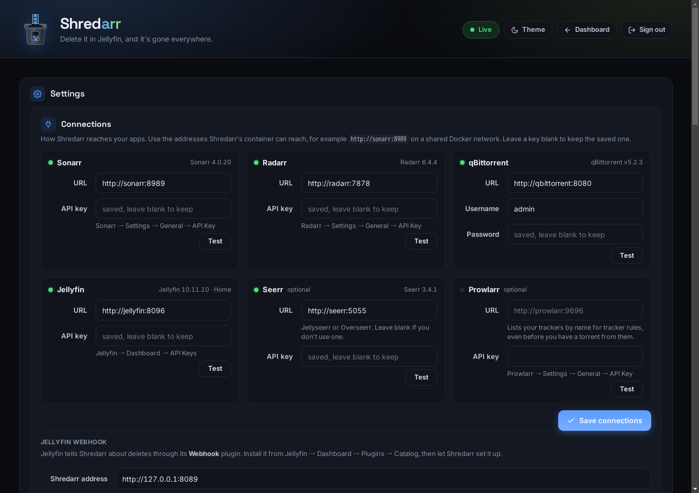
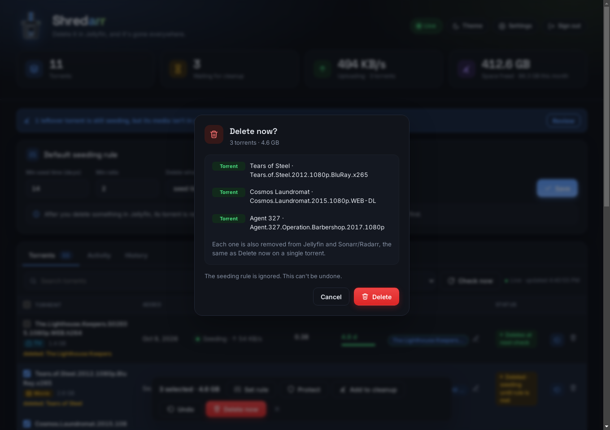
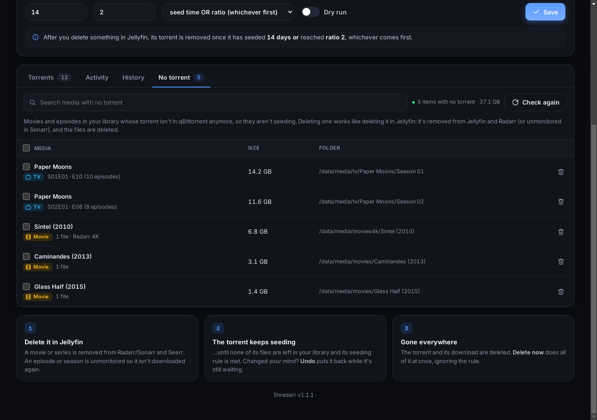
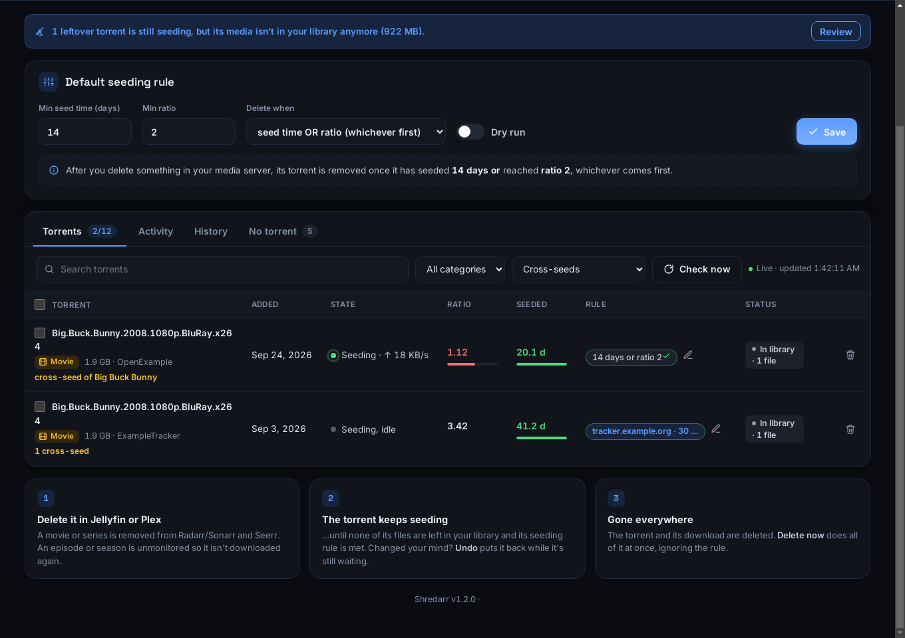
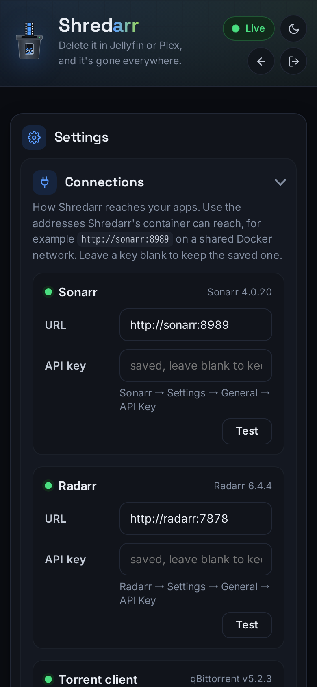

<p align="center"></p>

<h1 align="center">Shredarr</h1>
<p align="center"><b>Delete it in Jellyfin or Plex, and it's gone everywhere.</b></p>

When you delete a movie, show, season or episode in **Jellyfin** or **Plex**, Shredarr cleans it up everywhere
else: **Sonarr / Radarr** (including extra instances, such as a 4K one), **Seerr** (Jellyseerr/Overseerr) and your
torrent client (**qBittorrent**, **Transmission** or **Deluge**). It keeps the torrent seeding until
your seeding rule is met, then removes the torrent and its download, with an **Undo** in the meantime and a
**Redownload** afterwards.

<p align="center"></p>

---

## Features

- **One delete, everywhere.** Movies and whole shows are removed from Radarr/Sonarr (optionally with an import
  exclusion) and Seerr. Single episodes and seasons are unmonitored in Sonarr so they aren't downloaded again,
  while the show itself stays for future episodes.
- **Seeding rules.** Keep seeding until a minimum seed time and/or ratio is reached ("either", "both", "time
  only", "ratio only"), with extra rules per **category**, **show or movie**, or **tracker**, plus per-torrent
  overrides. Mark anything **Never delete** to protect it.
- **Tracker rules by name.** Trackers are named the way Sonarr/Radarr and Prowlarr know them ("TorrentDay"), so one
  rule covers all of a tracker's announce addresses. Connect Prowlarr to see trackers you have no torrents from yet.
- **Season packs are safe.** A torrent is only removed once *none* of its files are left in your library, so
  deleting one episode never breaks seeding for the rest of the pack. Works for hardlinked and RAR releases.
  Library files are matched to torrents by their identity on disk, not by name.
- **Cross-seed aware.** Cross-seeds (the same release seeding from other trackers, from the same data or hardlinked
  to it) are found automatically and cleaned up along with the original: each after its own tracker's seeding
  rule, or all together. Data another torrent still seeds from is never deleted out from under it.
- **Undo.** Changed your mind? While the torrent is still seeding, Undo re-adds the item to Sonarr/Radarr with its
  old settings and re-imports the file. RAR releases are unpacked again with the built-in unpacker.
- **Redownload.** Already gone for good? Every cleanup in History has a **Redownload** button: Shredarr puts the
  movie or episodes back in Sonarr/Radarr (with their old settings), then either re-adds the **same release** (it
  keeps a copy of each `.torrent`) or lets Sonarr/Radarr **search again**. Season packs and complete series come
  back as packs.
- **Deletion delay.** Optionally wait hours or days before removing a torrent, so there is always time to Undo.
- **Delete now.** Remove a torrent and its media everywhere immediately, with a preview of every step. If
  Sonarr/Radarr has since upgraded a movie or episode to a file from a different download, that one is left alone.
- **Media with no torrent.** Lists movies and seasons in your library whose torrent is gone (so they aren't
  seeding anymore), biggest first, and deletes them everywhere in one go.
- **Low disk space override.** Below a free-space threshold, waiting torrents go early, oldest first.
- **Leftover finder.** Spots torrents whose media is no longer in your library and lets you clean them up.
- **History.** Everything that was cleaned up, with sizes and a running "space freed" total.
- **Bulk actions.** Select many torrents to set a rule, protect, undo or delete them at once.
- **Notifications.** Discord (custom name and avatar), ntfy and Pushover: cleanups, problems, undos, deletes and a
  daily summary.
- **Connection health.** Shredarr checks every app every few minutes and tells you when one becomes unreachable.
- **A proper web UI.** Live torrent list, activity feed, light/dark theme, works great on phones (add it to your
  home screen), password-protected with reset codes.

## Screenshots

| | |
|---|---|
|  |  |
| **Torrents:** seeding progress toward each rule, where the rule comes from, and what happens next. | **History:** what was cleaned up and why, with Redownload. |
|  |  |
| **Settings:** connection status, one-click Jellyfin webhook setup, rules, notifications. | **Bulk actions:** select several torrents, preview, confirm. |
|  |  |
| **No torrent:** library media that isn't seeding anymore, ready to clean up. | **Cross-seeds:** found automatically and cleaned up with the original. |

<p align="center"></p>

The screenshots use made-up demo data; see [Try the demo](#try-the-demo).

## Requirements

- A media server: **Jellyfin** with the **Webhook** plugin (Dashboard → Plugins → Catalog → *Webhook*), or **Plex**.
- **Sonarr** and/or **Radarr**. More instances (say a 4K Radarr) can be added.
- A torrent client: **qBittorrent**, **Transmission** or **Deluge** (Deluge needs its **Label** plugin turned on
  for categories).
- **Seerr** and **Prowlarr** are optional.
- Shredarr must be able to see your **downloads and library** folders. The simplest setup is the common
  "one `/data` folder" layout (downloads and media on the same disk, imported with hardlinks), mounted into
  Shredarr at the same path your other apps use. If the paths differ, add a **path mapping** in Settings.

## Install (Docker Compose)

```yaml
services:
  shredarr:
    image: ghcr.io/jschaef80/shredarr:latest
    container_name: shredarr
    restart: unless-stopped
    ports:
      - "8089:8089"
    environment:
      - TZ=America/Chicago          # your time zone
    volumes:
      - ./shredarr:/config          # settings, history, saved .torrent files and the password hash
      - /path/to/data:/data         # the same folder Sonarr/Radarr and the torrent client see as /data
```

Then:

1. Open `http://<your-server>:8089` and create a password.
2. In **Settings → Connections**, enter the address and API key of Sonarr and Radarr, pick your torrent client and
   media server and enter theirs (and Seerr's or Prowlarr's if you use them). Use **Test** on each one, then
   **Save connections**. For a Plex token, open any movie in Plex → ⋯ → *Get Info* → *View XML*; the token is at the
   end of the address that opens.
3. **Jellyfin:** under **Jellyfin webhook**, enter the address Jellyfin can reach Shredarr at (for example
   `http://192.168.1.10:8089`) and click **Set up Jellyfin webhook**. **Plex:** nothing to set up (see below), but
   turn on *Allow media deletion* in Plex → Settings → Library so you can delete from Plex.
4. Pick your **default seeding rule** on the dashboard. Leave **Dry run** on until you've seen it do the right
   thing in the Activity tab.

> Shredarr writes into the `/data` mount only to unpack RAR releases for Undo (into a temporary folder next to the
> download, removed afterwards). Library files and downloads are only deleted through your media server,
> Sonarr/Radarr and the torrent client themselves.

## How it works

1. **You delete something in Jellyfin or Plex.** Jellyfin's Webhook plugin tells Shredarr (Jellyfin batches these,
   so it can take up to about 90 seconds). Plex can't tell other apps about deletes, so with Plex Shredarr watches
   your library folders: a movie or episode file that disappears and stays gone for a couple of minutes counts as
   deleted. Renames, upgrades by Sonarr/Radarr and a disk going offline are recognized and ignored.
2. **Sonarr/Radarr and Seerr are updated right away**, according to *Settings → Cleanup behavior*. Shredarr notes
   which torrents the item came from (from Sonarr/Radarr's download history) and saves a snapshot for Undo.
3. **The torrent keeps seeding** until none of its files are left in your library, its seeding rule is met and any
   deletion delay has passed. Then the torrent and its downloaded data are deleted from the torrent client, and the entry
   moves to History, ready for Redownload.

A deleted show or season whose folder still exists on disk is treated as Jellyfin tidying up an *empty* show, not
as a delete, so weekly shows don't disappear from Sonarr when you delete their latest episode.

**More than one Sonarr or Radarr** (for example a separate 4K instance): a delete is only applied to the instances
whose copy is really gone. Delete the 1080p version and the 4K one stays, and the other way round.

**Transmission and Deluge** can't hand out a torrent's `.torrent` file, so Redownload offers *search again* for
them (qBittorrent also gets *same release*).

## Settings at a glance

| Section | What it does |
|---|---|
| Connections | App addresses and keys (Seerr and Prowlarr are optional), connection status, Jellyfin webhook setup, path mappings |
| Seeding rules | Extra rules by show/movie, tracker or category; "Never delete" protects |
| Notifications | Discord, ntfy, Pushover, and which events to send |
| Cleanup behavior | Import exclusions, Seerr removal, unmonitoring, episode file records, cross-seeds |
| Deletion delay | Minimum wait before a torrent is removed (time to Undo) |
| Low disk space | Delete waiting torrents early when free space runs low |
| RAR restore | Unpack RAR releases again for Undo |
| Password | Change it, set password rules, sign out everywhere |

## Security notes

- The web UI needs a password. Sessions last 30 days; repeated wrong passwords are slowed down and blocked.
- Forgot the password? **Forgot password?** on the sign-in page sends a one-time code to your notification
  services and also writes it to `RESET-CODE.txt` in the config folder and the container log. You can also run
  `docker exec shredarr shredarr set-password 'new password'`.
- The Jellyfin webhook is authenticated with its own random token.
- API keys and passwords are stored in `config.json` in your config folder (readable only by its owner) and are
  never sent back to the browser. Tracker URLs are only ever shown as host names, never with your passkey.
- Shredarr is meant for your home network. If you expose it to the internet, put it behind a reverse proxy with
  HTTPS.

## Try the demo

Run Shredarr with made-up data (nothing is contacted or deleted), then open `http://localhost:8089` and sign in
with the password `demo`. Shredarr itself runs unchanged, against the same fake Sonarr, Radarr, qBittorrent, Jellyfin
and Seerr its tests use. You need [uv](https://docs.astral.sh/uv/):

```sh
git clone https://github.com/jschaef80/shredarr && cd shredarr
uv run tools/demo.py
```

## Updating

```sh
docker compose pull shredarr && docker compose up -d shredarr
```

Shredarr shows a notice in the footer and under *Settings → About* when a new release is available (you can turn
the check off there).

## Development

Shredarr is a Python package (FastAPI, httpx, and the qBittorrent, Transmission and Plex client libraries), managed
with [uv](https://docs.astral.sh/uv/). See [CONTRIBUTING.md](CONTRIBUTING.md) for how it's put together and how it's
tested.

```sh
uv sync                 # set up .venv with everything, including the dev tools
uv run pytest -n auto   # the test suite (fake apps on a temporary disk; nothing real is touched)
uv run ruff check . && uv run mypy src
```

## License

[MIT](LICENSE)
